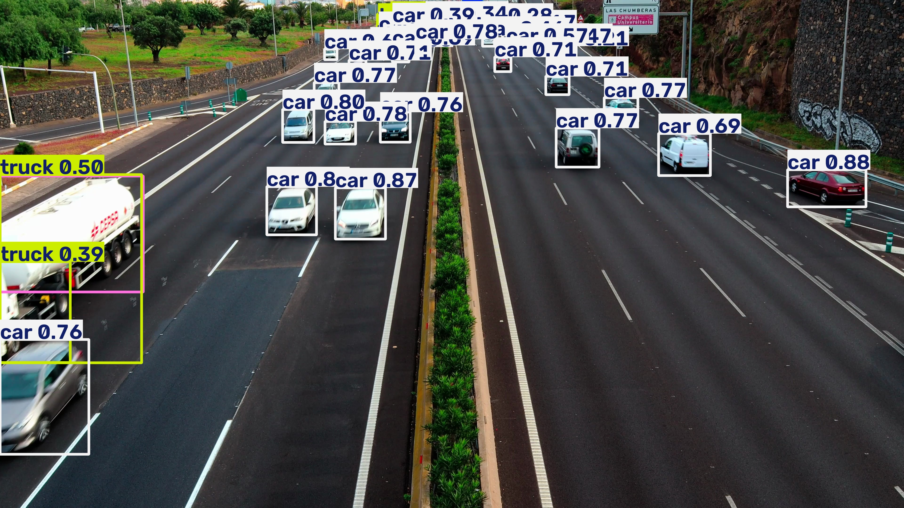
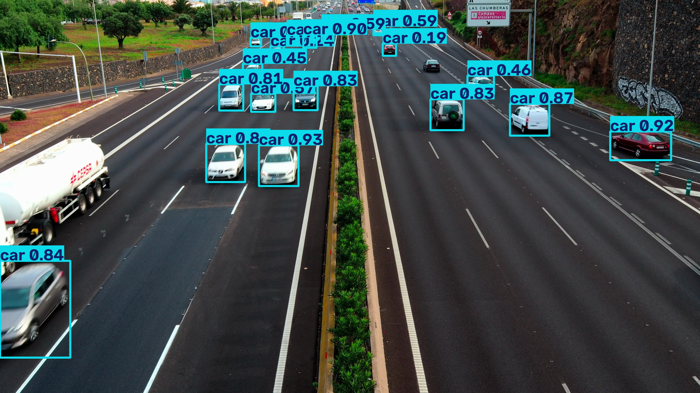
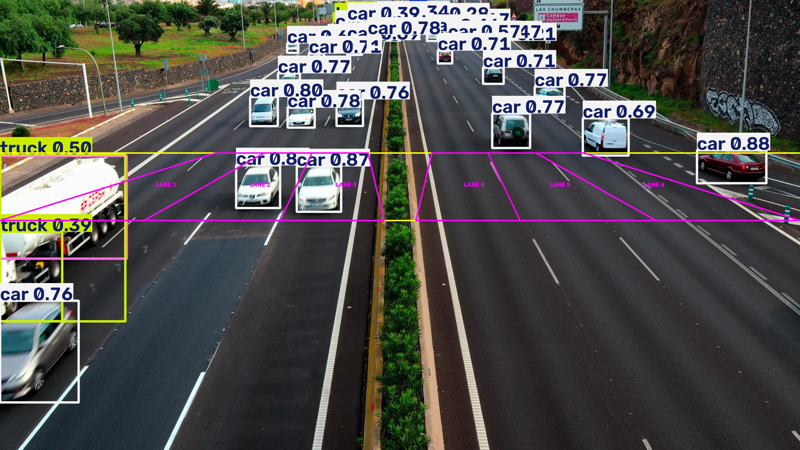
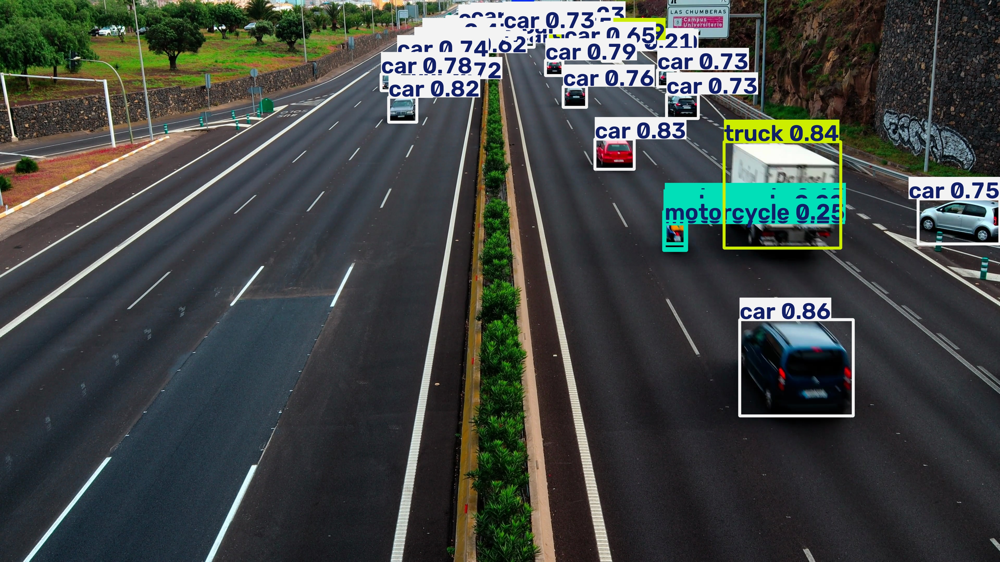
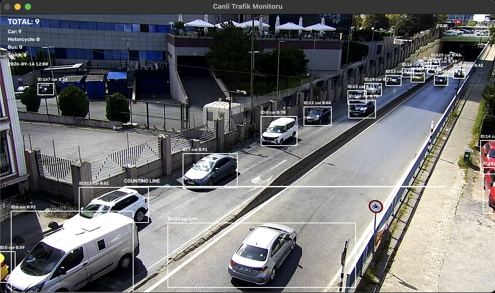

# AI-Powered Vehicle Detection, Tracking & Traffic Analytics System

An end-to-end computer vision project for vehicle detection, multi-object tracking, traffic counting, and traffic analytics using **YOLO11, ByteTrack, OpenCV, FastAPI, and SQLite**.

The system processes traffic videos and supports live-stream monitoring, vehicle classification, directional counting, lane-based analysis, and historical traffic statistics.

## Project Overview

This project aims to automate traffic monitoring and analysis through deep learning and computer vision.

The system supports:

- Detection of cars, buses, trucks, and motorcycles
- Multi-object tracking with unique tracking IDs
- Vehicle counting with duplicate-count prevention
- Direction-based traffic counting
- Lane-based traffic analysis
- Traffic density estimation
- Video upload and processed video output
- CSV report generation
- Live HLS camera monitoring
- Hourly traffic statistics stored in SQLite
- REST API and web-based interface

## Technologies Used

| Technology | Purpose |
|---|---|
| Python | Main programming language |
| YOLO11 | Vehicle detection |
| ByteTrack | Multi-object tracking |
| OpenCV | Video processing |
| FastAPI | Backend REST API |
| SQLite | Traffic data storage |
| SQLAlchemy | Database operations |
| HTML, CSS, JavaScript | Web interface |
| Chart.js | Traffic data visualization |
| JWT | User authentication |

## System Architecture

```text
Traffic Video / Live HLS Stream
              |
              v
       OpenCV Processing
              |
              v
       YOLO11 Detection
              |
              v
      ByteTrack Tracking
              |
              v
      Traffic Analysis
       /     |      \
 Counting  Lanes  Direction
       \     |      /
              v
      Traffic Statistics
              |
              v
        SQLite Database
              |
              v
         FastAPI API
              |
              v
       Web Interface
```

## Detection Results

### Pretrained YOLO11 Model

The pretrained YOLO11 model is used to detect vehicles in traffic scenes.



### Custom-Trained YOLO11 Model

A YOLO11n model was fine-tuned using a traffic-intersection vehicle detection dataset.



### Lane-Based Traffic Analysis

The system supports vehicle counting across predefined lane regions.



### Motorcycle Detection

Motorcycle detection is included alongside car, bus, and truck detection.



## Custom Model Training

A YOLO11n model was fine-tuned on a traffic-intersection dataset containing five classes: car, bus, truck, motorbike, and person.

The dataset contained 4,526 images, split into:

| Split | Images |
|---|---:|
| Training | 3,162 |
| Validation | 902 |
| Test | 462 |

Training configuration:

- Model: YOLO11n
- Epochs: 30
- Image size: 640
- Batch size: 16
- Environment: Google Colab with NVIDIA T4 GPU

### Model Evaluation

| Metric | Validation | Test |
|---|---:|---:|
| Precision | 0.869 | 0.840 |
| Recall | 0.910 | 0.922 |
| mAP@50 | 0.926 | 0.923 |
| mAP@50:95 | 0.661 | 0.678 |

These metrics evaluate object detection performance on the corresponding dataset splits, rather than end-to-end traffic counting accuracy.

The custom model is provided as an experimental comparison. The video analysis pipeline can also use pretrained YOLO11 weights.

## Example Traffic Analysis

In one experimental highway-video analysis, the system generated the following counts:

| Vehicle Class | Count |
|---|---:|
| Car | 76 |
| Bus | 2 |
| Truck | 3 |
| Motorcycle | 1 |
| **Total** | **82** |

Additional analysis results:

- Estimated traffic density: High
- Estimated vehicle flow: 243.56 vehicles/minute
- Upward direction: 23 vehicles
- Downward direction: 59 vehicles

These are system-generated experimental results, not manually verified ground-truth counts. Traffic density is based on a configurable rule-based threshold.

Lane regions and counting zones must be calibrated for each camera viewpoint.

## Live Traffic Monitoring

The live-monitoring module supports HLS video streams and uses YOLO11 with ByteTrack to detect, track, and count vehicles.

Features include:

- Live frame processing
- Vehicle classification and tracking
- Counting-line crossing detection
- Hourly traffic aggregation
- SQLite data storage
- Automatic reconnection attempts after stream interruptions

Live-stream availability depends on the external camera provider.


### Live Traffic Monitoring Demo




## Historical Traffic Analytics

The project provides SQL-based aggregation of hourly traffic records.

Historical analytics can be used to examine:

- Average vehicle counts by hour
- Vehicle-class distributions
- Traffic volume patterns
- Peak traffic periods

A separate seed script can generate **synthetic test records** for development. Synthetic data should not be interpreted as real-world traffic observations or forecasting results.

## Installation

### 1. Clone the repository

```bash
git clone https://github.com/tugcegok/AI-Traffic-Analysis-System.git
cd AI-Traffic-Analysis-System
```


### 2. Create a virtual environment

```bash
python3 -m venv venv
source venv/bin/activate
```

On Windows:

```powershell
venv\Scripts\activate
```

### 3. Install dependencies

```bash
python -m pip install -r requirements.txt
```

### 4. Configure environment variables

Create a `.env` file in the project root:

```dotenv
SECRET_KEY=replace_with_your_own_secure_random_secret
```

Never commit real secrets to version control.

### 5. Start the web application

```bash
uvicorn app.main:app --reload
```

Web interface:

`http://127.0.0.1:8000`

Interactive API documentation:

`http://127.0.0.1:8000/docs`

## API Endpoints

| Method | Endpoint | Description |
|---|---|---|
| GET | `/` | Web interface |
| POST | `/register` | User registration |
| POST | `/login` | User login |
| GET | `/me` | Authenticated user information |
| POST | `/analyze` | Analyze an uploaded video |
| GET | `/processed-video` | Access processed video |
| GET | `/download-report` | Download analysis report |
| GET | `/history` | Previous analyses |
| GET | `/hourly-stats` | Hourly analysis statistics |
| GET | `/live-traffic/cameras` | Available camera information |
| GET | `/live-traffic/history` | Live traffic history |
| GET | `/live-traffic/latest` | Latest live traffic records |
| GET | `/live-traffic/profile` | Hourly traffic profile |
| GET | `/live-traffic/summary` | Live traffic summary |

## Project Structure

```text
traffic_analysis_project/
├── app/
│   ├── analyzer.py
│   ├── auth.py
│   ├── database.py
│   ├── main.py
│   ├── models.py
│   ├── schemas.py
│   └── templates/
│       └── index.html
├── docs/
│   └── images/
├── models/
├── trackers/
│   └── bytetrack_traffic.yaml
├── live_traffic_monitor.py
├── historical_traffic_analysis.py
├── seed_historical_test_data.py
├── collect_live_frames.py
├── compare_models.py
├── requirements.txt
├── .gitignore
└── README.md
```

Trained model weights, uploaded videos, generated reports, database files, and local environment secrets are excluded from the repository.

For custom-model inference, provide your own compatible trained weights in `models/best.pt`. The pretrained YOLO11 weights can be obtained through Ultralytics.

## Limitations

- Counting accuracy depends on camera angle, visibility, occlusion, and tracking quality.
- Lane boundaries and counting zones are camera-specific.
- Live-stream processing depends on network and stream availability.
- Experimental counting results have not been independently validated against manually annotated ground truth.
- The project is intended for research, learning, and prototyping rather than production traffic enforcement.

## Dataset Acknowledgment

Custom training used the **Traffic Intersection Vehicle Detection** dataset, version 9, published by VAI on Roboflow Universe under the CC BY 4.0 license.

Dataset attribution and license requirements should be preserved when reusing the dataset or derived materials.

## Future Improvements

- More robust tracking under heavy occlusion
- Automated lane calibration
- Improved low-light and nighttime performance
- Multiple-camera analytics
- Expanded evaluation of counting accuracy
- Deployment and monitoring improvements

---

**Developed as a computer vision and traffic analytics project using Python, YOLO11, ByteTrack, and FastAPI.**
